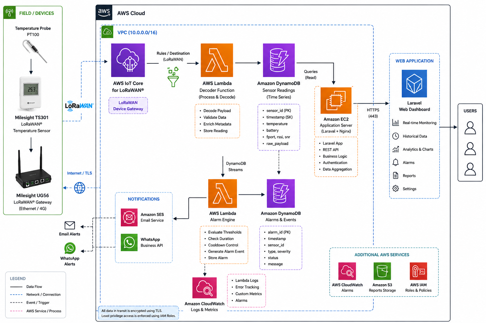
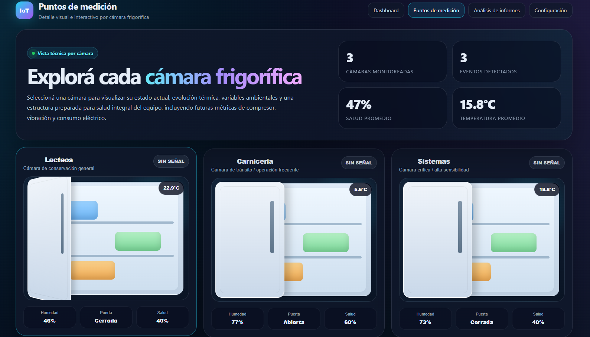
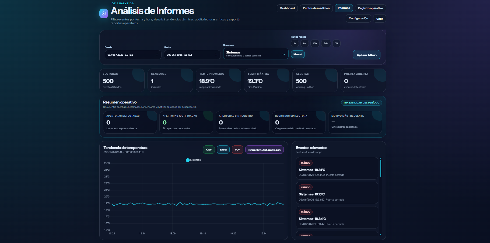

# AWS IoT Temperature Monitoring Platform

Production-ready IoT platform built on AWS for real-time temperature monitoring using LoRaWAN sensors.

## Overview

This project implements an end-to-end IoT monitoring platform designed for cold storage environments.

The solution receives telemetry from LoRaWAN temperature sensors, processes incoming data using AWS serverless services, stores historical readings, evaluates alarm conditions and provides a web dashboard for real-time monitoring and analytics.

The architecture was designed to be scalable and easily extensible to additional use cases such as fleet tracking, energy monitoring and industrial IoT.

## High Level Architecture

## AWS Services

| Service | Purpose |
|----------|----------|
| AWS IoT Core for LoRaWAN | Device connectivity |
| AWS Lambda | Payload decoding and alarm engine |
| Amazon DynamoDB | Time-series telemetry storage |
| DynamoDB Streams | Event-driven alarm processing |
| Amazon EventBridge | Scheduled jobs |
| Amazon SES | Email notifications |
| Amazon CloudWatch | Logs and monitoring |
| Amazon EC2 | Laravel web application |
| IAM | Security and permissions |

## Data Flow

1. Temperature sensor captures a reading.
2. LoRaWAN packet is transmitted to the Milesight gateway.
3. Gateway forwards telemetry to AWS IoT Core.
4. AWS IoT Core invokes the Decoder Lambda.
5. Lambda decodes the payload and stores telemetry in DynamoDB.
6. DynamoDB Streams trigger the Alarm Engine.
7. Notifications are sent via Amazon SES and WhatsApp.
8. The Laravel dashboard running on EC2 retrieves historical and real-time data.

## Features

- Real-time monitoring
- Historical telemetry
- Configurable alarms
- Email notifications
- WhatsApp notifications
- Automatic reports
- AI-generated summaries
- Multi-device support
- Multi-location support

## Dashboard

### Main Dashboard

---

### Analytics

---

### Reports

## Architecture Decisions

### Why AWS Lambda?

The solution follows an event-driven architecture. Lambda automatically scales according to incoming telemetry without requiring permanently running servers.

### Why DynamoDB?

Sensor readings are stored as time-series data. DynamoDB provides low-latency writes, automatic scaling and efficient timestamp-based queries.

### Why LoRaWAN?

LoRaWAN enables long-range communication while maintaining extremely low power consumption, making it ideal for battery-powered sensors deployed in industrial environments.

## My Contribution

Responsible for the complete solution architecture, AWS cloud infrastructure, LoRaWAN integration, backend development, dashboard implementation, serverless processing, alarm engine, reporting module and deployment.
